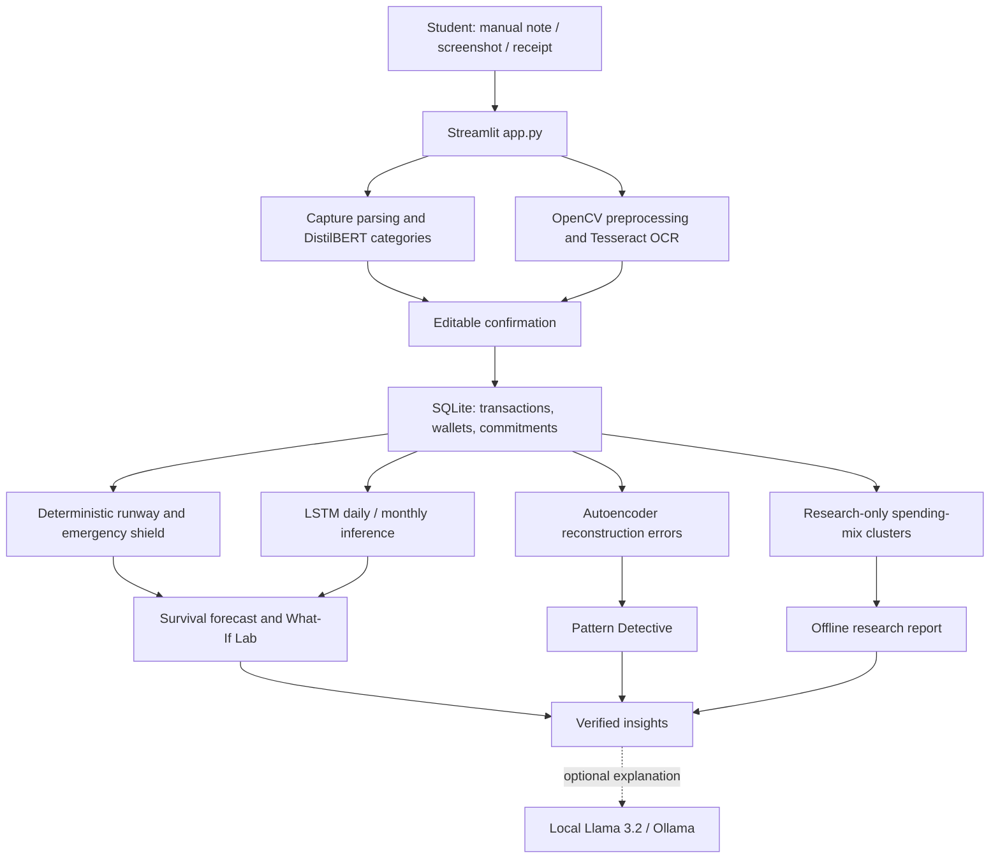

# Architecture

| Responsibility | Files |
|---|---|
| Navigation and forms | app.py, campus_ui.py, paper_theme.py |
| Multi-entry capture | capture.py, shopping.py, receipt_ocr.py |
| Storage and accounting | storage.py, campus.py |
| Learned inference | ml.py (style deployment disabled) |
| Survival/scenarios | survival.py |
| Descriptive insights and limit rules | intelligence.py, coach.py, analytics.py |
| Optional local conversation | ai_chat.py |
| Training, preprocessing and evaluation | training/ |
| Trained artifacts and metrics | models/research, models/campus, models/demo |
| Tests | tests/ |

No model changes database records by itself. Human confirmation is the save boundary. Financial scenario functions are pure calculations; the local LLM cannot execute tools or mutate records. SQLite is appropriate for a single-machine semester project with transaction support and no external service. Existing schema separates workspaces, wallet snapshot revisions and paid commitments to avoid replaying historical expenses against new balances.

The original submitted ZIP used Tkinter, category mapping and adapter code. Its desktop UI is not imported into the Streamlit stack; its suitable ideas (local records, category summaries, reviewable advice) are already represented in the reusable current modules. No original database is silently treated as personal spending.

## Boundaries

Currency-specific monetary models are isolated; INR forecasts never fund a PKR wallet. Dimensionless profile shares can be explored across schemas but do not establish Pakistani population validity. Missing data is not automatically complete data. Optional local chat may be unavailable while numerical planning stays usable.
