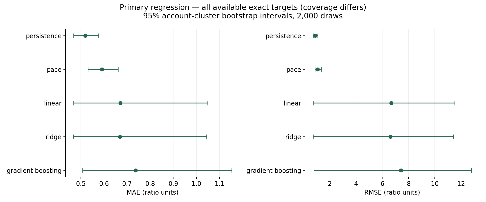
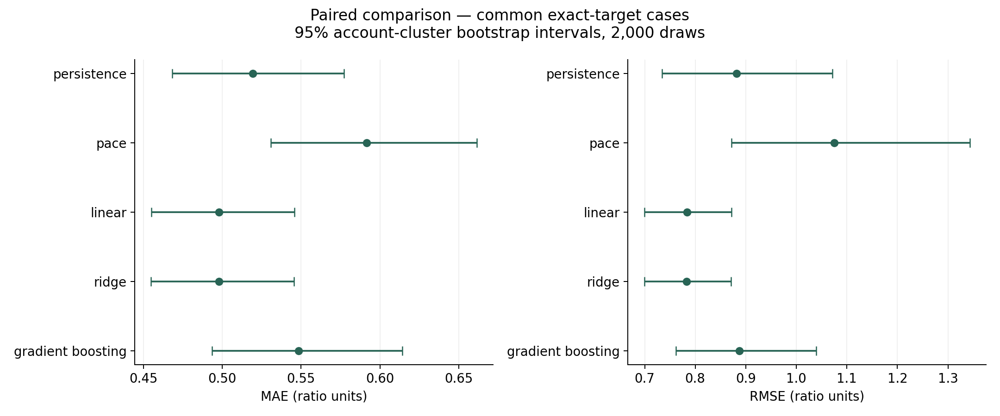
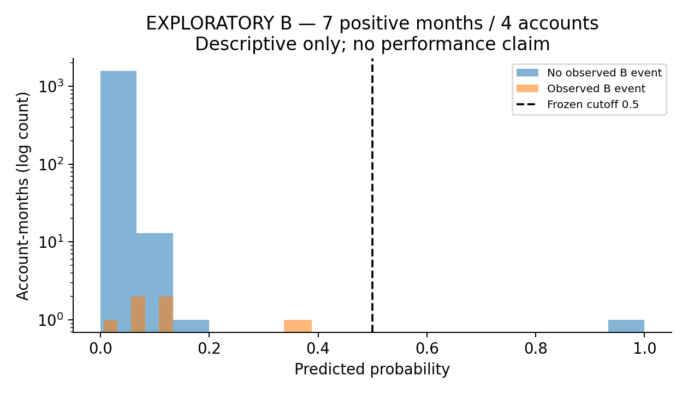
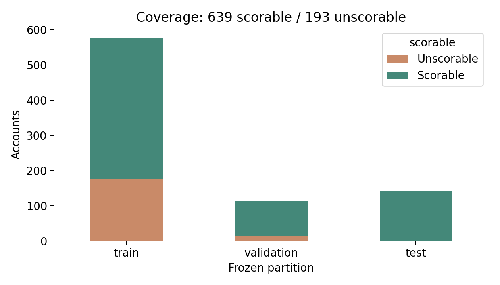
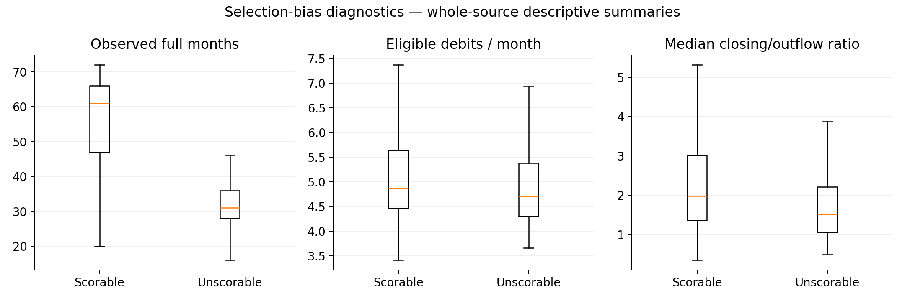

# Data audit and student adaptation

> **Authoritative revision: 19 November 2026.** The rebuild uses real data and from-scratch models only, with the chatbot LLM as the sole pretrained exception. The older audit below is retained as history; fictional student/campus sources, DistilBERT and Tesseract are excluded from the rebuild. The user explicitly dropped the student spending dataset and has not approved the optional unverified Personal Budget Transactions source.

## Berka source decision and verification

The original `data_berka.zip` supplied by the user downloaded completely (18,074,591 bytes) and passed the ZIP CRC check. Its SHA-256 is `affa4477572e9d8f2de6beff8a525d37c056d5d8e4a9670dd8c7636208c002ce`. `data/berka_original/` contains unchanged extracted `trans.asc`, `order.asc` and `account.asc`; file hashes and provenance are in that directory's `provenance.json`. The archive contains eight ASC tables, but only the three requested tables were extracted for this stage. CTU's source page labels the Financial dataset **Type: Real**. Public access does not by itself establish redistribution rights.

The MariaDB full-table stream was interrupted by the public server's statement-time limit. Its partial `trans.csv.part` was **deleted**, is not a training source, and is never treated as a full export. Completed MariaDB account/order exports remain comparison-only. `training/fetch_berka.py` now uses bounded primary-ID batches and validates final counts against `COUNT(*)`; this is a fallback, not the selected source. Any fallback must document its schema and precision differences and preserve currency/eligibility rules.

After the precision comparison below, the **original ASC files are selected as the Berka training source** under the user's instruction. No Berka model training has started.

| Original table | Rows | Actual columns |
|---|---:|---|
| account.asc | 4,500 | account_id, district_id, frequency, date |
| order.asc | 6,471 | order_id, account_id, bank_to, account_to, amount, k_symbol |
| trans.asc | 1,056,320 | trans_id, account_id, date, type, operation, amount, balance, k_symbol, bank, account |

All three original tables have unique primary IDs, no completely duplicated rows and no orphan transaction/order account IDs. Transactions cover all 4,500 accounts; 3,758 accounts have standing orders. Transaction dates run from 1 January 1993 to 31 December 1998. Dates in the original files are YYMMDD, not the ISO dates supplied by MariaDB. Account IDs represent accounts, not necessarily distinct people, and do not identify a verified student population.

## Amount and balance precision: original versus MariaDB

The original ASC values retain fractional CZK. The MariaDB schema declares both `trans.amount` and `trans.balance` as `int(11)`, losing fractional precision. The comparison used full-table counts/aggregates plus **24 deterministic matched-ID examples**, not a full row-by-row export/diff of MariaDB.

| Check | Original trans.asc | MariaDB trans |
|---|---:|---:|
| Rows | 1,056,320 | 1,056,320 |
| Rows with fractional amount | 319,128 | 0, integer schema |
| Rows with fractional balance | 934,450 | 0, integer schema |
| Zero-amount rows | 14 | 162 |
| Sum of amount observations (CZK) | 6,257,793,560.30 | 6,257,862,197 |
| Sum of balance observations (CZK) | 40,687,683,194.00 | 40,687,734,247 |

MariaDB's amount sum is higher by CZK 68,636.70; its balance-observation sum is higher by CZK 51,053.00. These are source-comparison aggregates across records, **not total customer wealth or net spending**. Sample transaction `695490` changes amount 14.60 to 15 and balance 71,437.80 to 71,438. Sample `3574567` changes amount 15.50 to 16 and balance 38,415.50 to 38,416. The matched examples show rounding consistent with integer conversion; the audit does not claim every row was compared or prove a universal conversion rule.

Full results: `eval/berka_precision_comparison.json`. Original source counts/schema/quality: `eval/berka_original_audit.json`. No rounding is applied to the selected original files.

## Missing-operation decision: retain and explicitly exclude from ML features

Empty or whitespace-only operation is treated as a missing operation **for labeling only**. The original `operation` field is never overwritten or filled. The requested cross-tabulation is:

| Original operation | k_symbol | type | Rows |
|---|---|---|---:|
| empty | UROK | PRIJEM | 183,114 |

There are no other k_symbol/type combinations among missing-operation rows. The original dictionary describes `UROK` as interest credited and `PRIJEM` as credit. Thus these observed missing-operation rows are interest credits, not unidentified retail purchases. They receive the user-specified `record_role = bank_generated/unknown_operation`; the label does not fabricate an operation value.

The shared policy helper is `app/data/berka_policy.py`:

- Keep every raw row and monetary value unchanged; do not drop or impute the 183,114 rows.
- `rows_for(..., 'cash_flow')` and `rows_for(..., 'balance')` retain **all 1,056,320 rows**, including those credits.
- Spending, anomaly and persona eligibility excludes that role, leaving **873,206 rows before any further task-specific direction/feature selection**. This is not a claim that all remaining rows are spending: credits/debits must still be handled using validated transaction directions.
- Persona feature numerators and denominators must both come from persona-eligible records. Do not indirectly reintroduce excluded interest credits through a cash-flow/savings proxy computed on the full ledger.
- This helper is for the revised pipeline. It has not been silently wired into the legacy model artifacts or used to claim new training results.

The policy was checked on the actual original data, with no fabricated rows: label/drop checks, unchanged source-frame values, full cash-flow amount sums, per-purpose row counts and raw-file SHA-256 integrity all passed. Results are in `eval/berka_policy_checks.json`.

## Other observed quality and interpretation limits

- Original trans has 535,314 empty/whitespace k_symbol values, 782,812 empty bank fields and 760,931 empty counterparty-account fields. Keep missingness explicit; never merge every unknown counterparty into one imaginary merchant.
- Original order has 1,379 whitespace-only k_symbol values. Its 6,471 rows include household payments, insurance, leasing and loans; they are not all subscriptions. There are no execution dates in the standing-order table, so it is only partial reference evidence for recurring-payment validation.
- There are 2,999 negative transaction-balance observations. They may be real overdrafts and are not anomaly ground-truth labels. Neither zero amounts nor negative balances are automatically dropped by this audit.
- Berka does not contain food categories or merchant-note text. Food share and true subscription share cannot be invented. Any proposed substitute persona feature needs an explicit, documented definition before the persona stage.

## Currency and feature restrictions

Berka is **CZK**. Raw amounts and balances remain in their historical units for source auditing and ledger calculations only. Models using Berka must receive only scale-free features such as ratios, shares and training-fitted z-scores. Any scaling parameters must be fitted on the training partition and reused on validation/test; fitting on all data would leak evaluation information. No raw CZK amount/balance model input, cross-currency monetary pooling, automatic PKR conversion or import into the student's PKR wallet is permitted. Household INR experiments remain separate; a single household is not manufactured into multiple independent users.

The feature pipeline is not trained or implemented yet; these restrictions are the contract for the following steps. No fictional student data or optional unverified extra source is used.

## Reproduce this stage

From `spendsense` (the original archive is already downloaded on this laptop):

```powershell
../.venv/Scripts/python.exe -m pip install -r training/data_requirements.txt
../.venv/Scripts/python.exe training/fetch_berka_original.py --archive ../work/berka_source/data_berka.zip --output data/berka_original
../.venv/Scripts/python.exe training/inspect_berka.py --folder data/berka_original --format asc --output eval/berka_original_audit.json
../.venv/Scripts/python.exe training/compare_berka_precision.py
../.venv/Scripts/python.exe training/check_berka_policy.py
```

`compare_berka_precision.py` makes read-only queries to the public MariaDB server. The source ASC files and wallet database are not modified. This stage validates data and policy, not ML model performance.

Sources: [CTU Financial](https://relational.fel.cvut.cz/dataset/Financial), [original archive](https://web.archive.org/web/20070214120527/http://lisp.vse.cz/pkdd99/DATA/data_berka.zip), [original dictionary](https://web.archive.org/web/20180506035658/http://lisp.vse.cz/pkdd99/Challenge/berka.htm).

---

<!-- BERKA_MODELING_V1_START -->
## Berka monthly low-balance modeling — completed evaluation

**Primary:** month-end balance/outflow ratio regression. **Secondary:** exploratory low-balance event B. The frozen definition, 5% thresholds, relaxed coverage, 832-account registry and account/time assignments are unchanged. All estimators were fitted from scratch; no pretrained models, recurrent networks, fictional rows, oversampling or target imputation were used.

## Authorization and development/test separation

The latest user instruction authorized training and account-grouped CV on pooled original train+validation data. This is recorded separately in `training_authorization_and_plan.json`; the original freeze JSON was not edited. Its historical `training_authorized=false` describes the earlier freeze stage, not a refusal of the later user authorization. Configuration lock: **2026-11-19T20:58:00+05:00**. Single final test prediction pass: **2026-11-19T21:03:47+05:00**. Each locked estimator made exactly one test prediction call; all subsequent metrics, plots and verification read `test_predictions_ONCE.csv`.

Outer split remains account-disjoint: original training targets through 1996, validation targets in 1997, test targets in 1998. Pooling train+validation was expressly authorized for this run; no account was reassigned and no target period was extended. The three-positive fixed validation subset was not used as an isolated tuning set.

Inner selection uses three deterministic account groups and forward validation years 1995, 1996 and 1997, giving nine possible folds. In each fold, fit only on other accounts with outcomes before the validation year. Thus validation accounts are unseen by that fold model, and its training targets precede its validation targets. All monthly features precede prediction origin. Scale parameters are fitted within each training fold; final models refit on development only. Each training account has equal total sample weight.

## Features and estimators

Eight regression features are all dimensionless: previous closing-balance lower/reference and upper/reference bounds; median previous-three-month net-flow/reference and credit/reference; previous-month net-flow/reference; and outflow/reference lags 1, 2 and 3. The exploratory binary model uses only the first five listed in `training_authorization_and_plan.json` (five actual columns: previous lower/upper, median net flow, lag-1 outflow, median credit). No current-month flow, future balance, identifiers or raw CZK value is a predictor. Unknown-operation credits remain in cash-flow/closing calculations and outside spending/anomaly/persona feature aggregates.

Unresolved previous closing snapshots are represented by observed interval bounds for learned models; no midpoint or exact closing balance is invented. Persistence and pace require a previous exact closing balance and therefore have slightly less coverage. Current-month unresolved targets are never imputed or scored as exact targets. No outputs were clipped.

| Family | Pre-test configuration |
|---|---|
| Persistence | Previous exact closing/reference scale known at origin. |
| Pace | Previous exact closing + median past-three-month net cash flow, divided by the same reference. |
| Linear regression | Unregularized linear baseline on standardized monthly ratios; equal-account weights. |
| Ridge | {'alpha': 1} |
| Shallow regression gradient boosting | {'n_estimators': 100, 'max_depth': 2, 'learning_rate': 0.05, 'min_samples_leaf': 100, 'random_state': 20261119} |
| Exploratory logistic regression | {'C': 0.1, 'solver': 'lbfgs', 'max_iter': 2000, 'tol': 1e-07, 'random_state': 20261119}; five features, L2 regularization, no class oversampling. |

Ridge candidates used alpha 0.1/1/10/100/1000; shallow regressor candidates had depth 1–2, 100 estimators and leaf minima 50–100. Logistic C candidates were 0.001/0.01/0.1, all regularized more strongly than the usual C=1 default. Selection criteria and the binary-boost gate were recorded before inspecting test predictions.

## Development results and locked choices

| Model | Grouped forward-CV common-case MAE | Grouped forward-CV common-case RMSE |
|---|---|---|
| persistence | 0.3932 | 0.7487 |
| pace | 0.4680 | 0.8341 |
| linear | 0.3923 | 0.7732 |
| ridge | 0.3920 | 0.7716 |
| gradient_boosting | 0.5358 | 1.1372 |

The development-selected primary pipeline was **ridge**, fixed before test. The shallow binary booster improved development Brier by only 0.364% versus the selected logistic model, its paired difference CI crossed zero and its average precision decreased. It failed the predeclared >=5%/paired-CI/AP gate, so no final binary booster was retained or tested. This decision did not use the seven test positives.

## Primary test result: all available exact targets

**Lead with this population, not the more favorable complete-baseline subset.** All methods below use their actual available exact targets. Coverage differs, so losses across different month sets are not a paired performance comparison.

| Model | Accounts / months | Account-macro MAE [95% CI] | Account-macro RMSE [95% CI] |
|---|---|---|---|
| persistence | 142 / 1558 | 0.519 [0.468, 0.577] | 0.882 [0.734, 1.071] |
| pace | 142 / 1558 | 0.591 [0.531, 0.661] | 1.075 [0.872, 1.344] |
| linear | 142 / 1575 | 0.671 [0.468, 1.049] | 6.680 [0.728, 11.521] |
| ridge | 142 / 1575 | 0.669 [0.468, 1.044] | 6.620 [0.727, 11.417] |
| gradient boosting | 142 / 1575 | 0.737 [0.508, 1.153] | 7.417 [0.787, 12.790] |

Development-selected ridge has full-target MAE **0.669 [0.468, 1.044]** and RMSE **6.620 [0.727, 11.417]**, on 1575 months in 142 held-out accounts. Units are ratios of typical monthly outflow, not CZK or PKR. The large RMSE and wide interval are material results, not hidden outliers.

One exact test ratio is approximately 303.57 and the locked ridge prediction is approximately 563.32. This case is among the 17 months where exact previous-closing inputs are unavailable to the persistence/pace baselines. It strongly affects the learned models' full-target RMSE. No case was removed, clipped, winsorized or used to refit a model. `post_lock_extreme_ratio_diagnostic.csv` and `extreme_ratio_notes.json` are post-lock descriptive diagnostics only.



## Fair paired comparison: common baseline cases

All five locked regression methods can be compared on the same 1,558 exact-target months in 142 test accounts. This supplementary common-case table does not replace the full-target results above.

| Model | Accounts / months | Account-macro MAE [95% CI] | Account-macro RMSE [95% CI] |
|---|---|---|---|
| persistence | 142 / 1558 | 0.519 [0.468, 0.577] | 0.882 [0.734, 1.071] |
| pace | 142 / 1558 | 0.591 [0.531, 0.661] | 1.075 [0.872, 1.344] |
| linear | 142 / 1558 | 0.498 [0.455, 0.546] | 0.784 [0.699, 0.871] |
| ridge | 142 / 1558 | 0.498 [0.455, 0.546] | 0.783 [0.699, 0.871] |
| gradient boosting | 142 / 1558 | 0.548 [0.494, 0.614] | 0.888 [0.762, 1.040] |

| Paired difference: locked ridge minus baseline | MAE difference [95% CI] | RMSE difference [95% CI] |
|---|---|---|
| persistence | -0.021 [-0.058, 0.005] | -0.099 [-0.268, 0.013] |
| pace | -0.094 [-0.146, -0.054] | -0.292 [-0.536, -0.128] |

The paired MAE and RMSE difference intervals versus persistence both include zero: **no clear improvement over persistence is established**. The paired intervals versus the specified pace rule are below zero on these common cases, but this is a result for this selected historical cohort and rule, not evidence of student-app generalization. The model preference remains the pre-test CV choice; it was not changed after seeing this table.



## Secondary binary B — EXPLORATORY only

The locked logistic model is scored on 1591 test account-months in 142 accounts. There are **7 positive months across 4 accounts**. These are too few for a reliable performance claim. Numbers below are descriptive only. The probability threshold remains 0.5, distinct from the 0.05 balance-ratio threshold.

| Descriptive metric | Value / treatment |
|---|---|
| Account-weighted average precision | 0.3430; valid-draw CI [0.011375566527864645, 0.6388888888888888] |
| Account-macro Brier | 0.005441; CI [0.001150186939048506, 0.011444826943205307] |
| Raw confusion at probability 0.5 | {'tn': 1583, 'fp': 1, 'fn': 7, 'tp': 0} |
| Zero-positive bootstrap draws | 34 / 2000 |
| Zero-negative bootstrap draws | 0 / 2000 |
| AP undefined / valid draws | 34 / 1966 |
| Precision undefined / valid draws | 728 / 1272; interval unavailable (>5% undefined). |
| Recall undefined / valid draws | 34 / 1966; valid-draw interval [0, 0]. |
| Brier valid draws | 2000; mathematically defined even on single-class resamples. |

At the frozen cutoff, the exploratory classifier has zero true positives and seven false negatives; it is not a validated warning system. AP is non-interpolated account-weighted average precision, not trapezoidal PR area. Single-class draws are left undefined for AP; recall without actual positives and precision without predicted positives are undefined. They were not replaced with zeros or resampled until positives appeared. AP/recall intervals condition on the 1,966 defined draws and remain fragile with only four positive accounts. Precision has 728 undefined draws (36.4%), so its interval is withheld under the frozen >5% rule. Every draw is saved for audit.



Month-end warnings derived by thresholding continuous predictions are evaluated against month-end low-ratio truth in `derived_month_end_warning.json`. That is a different outcome from earlier-month B; its confusion counts are not used to tune the threshold or claim event-detection performance.

## Scorable versus unscorable accounts and selection bias

| Partition | Registered | Scorable | Unscorable |
|---|---|---|---|
| Train | 577 | 400 | 177 |
| Validation | 113 | 97 | 16 |
| Test | 142 | 142 | 0 |
| Total | 832 | 639 | 193 |

Of the 193 unscorable accounts, 192 lack an eligible origin inside their assigned target period and one has only unresolved assigned targets. They are retained in the registry and are not treated as safe negatives or assigned invented regression errors. Here scorable refers to the continuous primary target: B can be observed without a uniquely resolved month-end closing balance, so one additional validation account remains available to the binary model. Model-specific common-case coverage is also reported: only 637 accounts across all partitions have exact inputs for the deterministic baselines, versus 639 with at least one exact target for learned models.

| Whole-source account median [IQR] | Scorable | Unscorable |
|---|---|---|
| Observed full months | 61.000 [47.000, 66.000] | 31.000 [28.000, 36.000] |
| Eligible debit records/month | 4.875 [4.466, 5.642] | 4.706 [4.310, 5.382] |
| Ledger records/month | 7.379 [6.708, 8.111] | 7.286 [6.639, 7.857] |
| Active debit-month fraction | 0.985 [0.976, 1.000] | 0.975 [0.962, 1.000] |
| Median month-end balance/outflow ratio | 1.987 [1.363, 3.022] | 1.513 [1.057, 2.219] |

| Partition/group | Accounts | Median debits/month [IQR] | Median closing ratio [IQR] |
|---|---|---|---|
| train/scorable | 400 | 4.937 [4.492, 5.609] | 2.098 [1.439, 3.171] |
| train/unscorable | 177 | 4.725 [4.326, 5.414] | 1.523 [1.113, 2.219] |
| validation/scorable | 97 | 4.712 [4.400, 5.600] | 1.715 [1.354, 2.453] |
| validation/unscorable | 16 | 4.362 [4.158, 4.711] | 1.044 [0.790, 2.455] |
| test/scorable | 142 | 4.941 [4.418, 5.771] | 1.742 [1.226, 2.855] |
| test/unscorable | 0 | N/A | N/A |

Scorable accounts have median first observation in November 1993 versus May 1996 for unscorable accounts, median 61 versus 31 full months, and median closing/outflow ratio approximately 1.99 versus 1.51. The evaluated sample favors longer-established, higher-buffer accounts. This is evidence of selection differences, not a causal effect or a quantified error rate for excluded accounts. Ever-negative counts are 34/639 versus 11/193, but observation spans differ; those proportions are not exposure-adjusted comparisons. Standardized mean differences and per-account summaries are saved. These whole-source diagnostics include dates beyond modeling cutoffs and were not used as training features or selection objectives. Boxplots omit flier markers for readability only; no records are removed from summaries or metrics.





## Bootstrap and audit details

Every reported regression interval uses 2,000 account-cluster bootstrap draws (seed 20261119), retaining all observed months for each sampled account. Compute mean monthly loss inside each account, then average accounts equally; RMSE is the square root of the account-macro squared loss. Paired common-case comparisons reuse identical draws. No month-level IID bootstrap or synthetic training rows are used. The draw-level MAE/RMSE and binary diagnostics are saved. Intervals are conditional on the sampled historical bank/calendar periods and do not capture all domain shift or cross-account shared economic shocks.

Verification passed: 126 grouped forward CV fits checked, 4 final development refits, fold/outer-account separation, development-only scaler means, source/protocol/cohort/split hashes, one test pass and independently reconstructed cached bootstrap intervals. The original frozen JSON SHA-256 remains `7080ca1de0a1b42b7cb79d7dfac6970a66fe6ebcb78640a73311728817feb6a8`. Reporting was updated to lead with all available exact targets; no estimator was rescored or changed during that reporting update.

## Paste-ready limitations paragraph

The continuous target is the month-end closing-balance/outflow ratio, whereas low-balance event B is an observed dip below 5% of prior typical outflow before the last calendar day; thresholding a month-end prediction does not identify every earlier dip or prove that a person lacks money elsewhere. The binary test outcome contains only seven positive account-months across four accounts, so the classifier results are exploratory and support no performance or deployment claims; 34 of 2,000 account-cluster bootstrap draws contained no positives, and undefined metrics were disclosed rather than replaced with zeros or resampled away. Only 639 of the fixed 832 accounts have exact targets in their assigned periods; 193 remain unscorable, and the scorable group has longer observed histories and higher median balance/outflow ratios, limiting population representativeness. Some closing balances cannot be uniquely ordered from dated transactions and are not imputed. Ratio errors are sensitive to small outflow denominators, producing a wide full-target RMSE interval; no test-driven clipping or threshold changes were made. Berka describes a non-student Czech banking population in 1993–1998, not contemporary Pakistani students; normalized features remove currency units but do not remove geographic, temporal or behavioral domain shift.

## Files and safe reproduction

Metrics: `regression_all_available_metrics.csv`, `regression_test_metrics.csv` (common cases), `regression_results.json`, `exploratory_binary_results.json`, `derived_month_end_warning.json`. Selection: `training_authorization_and_plan.json`, `cv_design.json`, both CV JSONs, configuration lock/digest and `pre_test_verification.json`. Audit: `test_evaluation_ledger.json`, saved predictions, bootstrap draw CSVs, `selection_bias.json`, `account_selection_bias.csv`, post-lock diagnostic and `verification.json`. Standalone plots are in `plots/`. Trained model bundles/cards are in `models/berka_low_balance_v1/`.

The development/preparation/scoring commands are documented in source, but **do not rerun the test scorer or retune models on this test**. Its exclusive ledger prevents a second scoring pass. To reproduce tables, checks and plots from the already saved predictions, from `spendsense`:

```powershell
../.venv/Scripts/python.exe eval/analyze_berka_models.py
../.venv/Scripts/python.exe eval/verify_berka_modeling.py
../.venv/Scripts/python.exe eval/render_berka_modeling.py
```
<!-- BERKA_MODELING_V1_END -->

---

> The following freeze section is a historical snapshot. The training results above reflect the later explicit authorization; frozen definitions and hashes are unchanged.

<!-- BERKA_LOW_BALANCE_V1_START -->
## Frozen monthly low-balance protocol v1

**Frozen: 2026-11-19T20:04:04+05:00 (Asia/Karachi). No model has been trained.** The selected outcome is **low-balance event, definition B**, using **relaxed coverage**. Prior competing definitions/coverage experiments are retired; A is retained only for the explicitly requested aggregate audit. Earlier proposal artifacts are historical, not active target rules.

### Authorized pre-freeze positive counts

The table uses the fixed 832-account population and the unchanged account-disjoint chronological assignment. It reports only positive account-month/account counts, including the explicitly authorized test feasibility check. No test performance metric, threshold search, model fitting or split tuning was performed.

| Partition | A positive account-months | A positive accounts | B positive account-months | B positive accounts |
|---|---|---|---|---|
| train | 32 | 10 | 40 | 11 |
| validation | 2 | 2 | 3 | 2 |
| test | 5 | 2 | 7 | 4 |

**The test cohort has 7 positive B account-months, below the requested approximately-20 threshold. The binary event classifier is frozen as exploratory.** This does not change definition B, its 5% threshold, the coverage policy or the split. Counts differ from the earlier broader relaxed comparison because this protocol now uses the explicitly requested fixed 832-account population.

### Population and relaxed observation policy

`eval/berka_low_balance/cohort_832.csv` contains all **832 fixed account IDs**. SHA-256: `7d0489d06db287e2a1083aaaa37db06d890e77274199b3b188aea90947c00e43`. Their groups are 577 train, 113 validation and 142 test accounts. These IDs were explicitly retained from the previously reviewed eligibility report; their historical ascertainment used the earlier full-source eligibility analysis. That is population provenance only: the old coverage filter is not reapplied to target months. Consequently this is a retrospective selected cohort, not prospective admission or a claim about every account in the bank.

At each monthly origin require 12 completed prior months, historical mean >=4 eligible debits/month and >=80% active prior full months. A target month uses relaxed coverage: it lies within the observed source span and has **at least two distinct observed transaction dates, with no maximum-gap limit**. Future transaction density is only retrospective outcome-availability metadata, never a model feature. Missing/unobserved events are not proven safe outcomes.

Let S(M) be the **median observed monthly eligible-debit outflow** in the three full calendar months preceding target month M. Each of those three months must contain >=3 eligible debit records, S(M)>0, and the previous month-end balance snapshot must already be observed at the prediction origin. Eligible debit means known operation and raw type VYDAJ or VYBER. This includes debt/service payments until the user separately approves a category mapping; it is not assumed to be discretionary consumption.

### Selected secondary binary event and continuous primary target

**Prediction origin:** 00:00 on the first calendar day of M. Predictors use only prior months.

**Selected binary B:** at least one observed post-transaction balance divided by S(M) is **strictly below 0.05**, on a date **strictly before the last calendar day of M**. Negatives qualify. Name this a **low-balance event**, never a claim about all money a person owns.

**Primary continuous target:** `month_end_ratio(M) = exact closing balance on the last calendar day of M / S(M)`. It is dimensionless, signed, and not clipped or winsorized. The denominator is fixed from information available before M; it is never recomputed from M's actual outflow.

**Derived warning:** predicted month-end ratio <0.05. Its ground truth is the measured month-end ratio <0.05. This **month-end warning is distinct from selected B**: an earlier dip can recover before closing, and a closing-day dip can occur without a pre-last-day B event. Do not claim thresholding a month-end prediction detects every earlier-month event. Logistic regression addresses B as an exploratory classifier; it is not a continuous regressor.

### Exact month-end measurement and missing-target disclosure

There are no within-day timestamps, so highest trans_id/file order, averaging last-day snapshots or carrying an old day forward is not permitted. Keep all ledger rows, including bank-generated interest credits, for closing-balance measurement. If every last-day observed balance is equal, closing balance is unambiguous. Otherwise each signed amount and post-balance defines a before→after ledger edge. A connected valid directed Euler trail with a unique terminal vertex identifies closing balance without choosing an arbitrary transaction order. Amounts/balances are checked in integer cents; no source value is changed.

| All-source month-end measurement status, 832 accounts | Months |
|---|---|
| unique_ledger_terminal | 38133 |
| single_or_equal_snapshot | 3506 |
| unresolved_degree | 843 |
| unresolved_disconnected | 1 |

If no unique terminal can be established, retain min/max last-day balance bounds and mark the scalar target unresolved. Do not impute an operation, midpoint, closing balance or scalar label. These intervals are audit bounds; interval-distance scores must not be presented as ordinary exact-target MAE/RMSE.

All **832** registered accounts have exact continuous targets somewhere in the original source (27,413 eligible origin-months). Under the fixed assigned target years, only **639 accounts** currently have exact scorable targets. The remaining **193** remain in the registry with explicit unscorable status; do not silently drop them or claim 832 accounts were scored. Exact scoring on every one of the 832 is **not achievable under the unchanged split and measurement rules**. Any future change to address this requires a separately documented amendment, not test-informed reshuffling.

| Partition | Registered accounts | Accounts with valid origins | Exact target months | Accounts with exact targets | Common baseline target months | Accounts with common baseline targets |
|---|---|---|---|---|---|---|
| train | 577 | 400 | 7399 | 400 | 7286 | 399 |
| validation | 113 | 98 | 956 | 97 | 945 | 96 |
| test | 142 | 142 | 1575 | 142 | 1558 | 142 |

Publish per-account target availability for the full 832-account registry, unscorable reasons, and actual scored account/month denominators with every later evaluation. The core comparisons use common exact-target/input cases, while separately reporting each method's prediction availability. This is a material coverage limitation; it is not resolved by increasing sample size with fictional records.

### Frozen account/time split

Keep `int(SHA256("spendsense-berka-split-v1:" + account_id), 16) % 100`: 0–69 train, 70–84 validation, 85–99 test. The original whole-bank assignment remains unchanged (3,162/664/674 accounts); the fixed 832-account cohort is its subset (577/113/142). Client linkage was checked from original disp.asc: no shared client crosses these groups.

| Partition | Target dates | Historical input rule |
|---|---|---|
| Train | Through 1996-12-31 | Only assigned train accounts and observations strictly before each monthly origin. |
| Validation | 1997-01-01 to 1997-12-31 | Own assigned accounts’ past only; no fitted validation transforms. |
| Test | 1998-01-01 to 1998-12-31 | Own assigned accounts’ past only; no model/threshold selection on outcomes. |

Assignment-file SHA-256: `bfb63ec317303fba00c431d3529bae368e4875080ed3f9d3d69a0cfa9330543b`. Labels must end wholly inside their assigned target periods. Past lookback may cross a year boundary only for that same assigned account. Fit all scaling, encoding, feature selection and estimator parameters on train only; validation may support later predeclared model selection. Test is used once for final evaluation after that selection. The only test outcome release in this step is the user-requested A/B positive count table. No per-row test target values, warning labels, model predictions or performance metrics are exported.

### Monthly features and baseline roles

**Berka has monthly features only. No daily LSTM, GRU or other recurrent Berka model belongs to v1.** Features may be lagged monthly balance/reference, inflow/reference, outflow/reference, net-flow/reference, payment shares, activity ratios or training-fitted z-scores. Account/client/counterparty IDs and raw CZK amounts/balances are not predictors. Preserve the approved unknown-operation exclusions for spending/anomaly/persona features; full ledger cash flow and closing balances retain bank-generated credits. Never import Berka amounts into the PKR wallet.

| Baseline | Frozen role / definition |
|---|---|
| Last-month ratio | Previous exact month-end closing balance / current known S(M): persistence on the same target scale. |
| Monthly pace rule | (Previous exact closing balance + median observed net cash flow in the previous 3 months) / S(M). Uses past monthly cash flow, including bank-generated credits; no daily extrapolation. |
| Logistic regression | Exploratory binary classifier for selected B only; cannot predict the continuous primary target. |
| Gradient boosting | Regressor for the continuous primary target; a separate exploratory B classifier may be benchmarked when training is later authorized. |

A previous closing balance that cannot be resolved remains unavailable to the persistence/pace baselines; no midpoint is substituted. The deterministic baseline values saved for development are calculations, not fitted models or reported model performance. No test baseline predictions are exported. Binary probability reporting uses a fixed 0.5 cutoff; the derived ratio warning uses the separately fixed 0.05 cutoff. Do not confuse probability with a balance ratio.

### Future evaluation and bootstrap confidence intervals — plan only

Primary continuous metrics: **account-macro MAE** and **sqrt(account-macro monthly mean squared error)**, in ratio units. Calculate each account's mean monthly loss, then give accounts equal weight. Do not clip large/negative ratios after looking at test results. Report actual scorable accounts and months, rather than implying the whole registry has exact labels.

Use **2,000 account-cluster bootstrap draws**, seed **20261119**, with replacement within each partition, preserving all months for each selected account. Give 95% percentile intervals (2.5%/97.5%). Use the same draws for paired baseline-loss differences on common evaluable accounts. Resampling observed accounts is not generation of new training data. These intervals are conditional on the observed bank/calendar periods and do not prove generalization to student finances.

Report the derived month-end warning against month-end truth separately from the exploratory B classifier. For B, predeclare PR-AUC, Brier score and precision/recall/confusion counts at fixed probability 0.5. Record how many bootstrap draws have no positive/negative examples and yield undefined metrics; never keep resampling until a positive appears. If >5% are undefined, mark that interval unreliable/unavailable. No bootstrap confidence intervals have been computed yet because there are no fitted predictions.

### Freeze integrity, status and reproduction

Canonical contract: `app/data/low_balance_protocol_v1.json`, SHA-256 `7080ca1de0a1b42b7cb79d7dfac6970a66fe6ebcb78640a73311728817feb6a8`. A copy and digest are in `eval/berka_low_balance/`. The freeze script refuses to overwrite v1; changes require an explicit versioned amendment. `training_authorized=false`, `model_fits=0`. The event classifier is exploratory because the authorized test count is below 20; the count was not used to tune definitions or thresholds.

Current artifacts: `cohort_832.csv`, `pre_freeze_AB_counts.json`, `target_availability.json`, `cohort_target_availability.csv`, `monthly_target_availability.csv`, development-only targets/baseline calculations, protocol/digest and verification report. Earlier competing proposals are historical only. Future training remains blocked by the current instruction.

From `spendsense`, check and render without fitting anything:

```powershell
../.venv/Scripts/python.exe eval/verify_low_balance_protocol.py
../.venv/Scripts/python.exe eval/render_low_balance_protocol.py
```
<!-- BERKA_LOW_BALANCE_V1_END -->

---

## Historical audit — excluded legacy sources and prior design

Checked supplied CSVs, saved metadata and the original project archive on 18 November 2026. No additional participant dataset was invented.

| Source | Availability / schema | Suitability | Attribution / permissions status |
|---|---|---|---|
| Daily Household Transactions | Bundled original 2,461 rows; 2,301 cleaned after excluding transfers/invalids. Date, amount, income/expense, category, note; INR; one household | Description categorization and reference time-series pipeline; cannot validate Pakistani student spending | Retrieved mirror: https://github.com/sanjanakrishnaraj0-lang/Daily-Transaction-Analysis . Exact original Kaggle attribution/license not established from supplied proposal. Confirm before public redistribution; no license is inferred from public availability. |
| SROIE | Five sample images and company/date/total annotations; full benchmark not bundled | Receipt extraction smoke test; Malaysian layouts differ from Pakistani receipts and carts | Challenge paper https://arxiv.org/abs/2103.10213 and supplied mirror https://github.com/zzzDavid/ICDAR-2019-SROIE . Another maintained dataset card https://huggingface.co/datasets/jsdnrs/ICDAR2019-SROIE reports CC-BY-4.0 for its distribution; verify original challenge and exact mirror terms before public distribution. |
| WFP Pakistan | 14,345 retail observations, PKR, date/market/commodity/unit | Historical grocery context; not student bank transactions | Source https://data.humdata.org/dataset/wfp-food-prices-for-pakistan . Five markets, no Sukkur; last bundled observation 15 September 2026. Consult source terms before public distribution. |

## Student adaptation and evaluation plan

1. Ask consenting students to log timestamped expenses, category, description, currency and optional hostel/commute context. Remove names, account details and full email contents from a shared research copy. Do not reuse personal records without permission.
2. Use the common transaction schema in training/train.py. Keep every individual's series separate and preserve dates/currency. Maintain an explicit statement of logging coverage.
3. Manually review Pakistani campus phrases (chai, canteen, printing, rickshaw) and verify receipt/cart totals, shipping, discounts and currency.
4. For categorization, deduplicate descriptions before splitting; a future collection should also hold out participants and repeated merchant patterns. The existing reference split is stratified by label, not an external campus test.
5. Fit time-series scales on training history only; split chronologically. Report rolling one-day and recursive multi-day metrics separately. Compare a last-seven-day mean baseline. Unknown/missing spending days must not be interpreted as known zeros without coverage confirmation.
6. Calibrate anomaly thresholds separately from a labelled independent evaluation if labels become available. With no anomaly labels, precision/recall are not measurable.
7. Examine cluster centers and stability, not just the best-looking silhouette. Avoid forced personality labels and psychological interpretations.
8. Evaluate OCR on a held-out local annotated set with varied layouts, image quality and merchants; report sample size, exact field matching and failures. The five-image smoke sample is far too small for a broad accuracy claim.

No current reference or synthetic result establishes accuracy for Pakistani students. Licensing/attribution items above remain explicit final-publication limitations, not silently resolved claims.

## Follow-up Kaggle audit

Direct Kaggle download soumojit11/daily-household-transactions matches the bundled raw household file; its publisher reports CC0. This identifies a reproducible Kaggle-hosted copy, but is not proof that this reupload is the original creator. A separately downloaded MIT-labelled Personal Finance history adds 617 cleaned reference expenses. See KAGGLE_TRAINING.md for actual retraining, evaluation, exclusions and currency boundaries. Several other Kaggle candidates were rejected after inspecting their records.


## Real-data spending-mix rebuild, 19 November 2026

See [step 1 report](../eval/spending_mix_v1/REPORT.md). Known generated sources and derived artifacts have been removed from active training, evaluation, demos and documentation. Berka train-assigned accounts only; six-full-month/20-debit/80%-active eligibility; original unknown-operation exclusion; dimensionless timing/concentration features. Household and personal-reference windows retain one entity per history. Research-only clusters are not deployed. Frozen risk protocol, split and test artifacts are unchanged. Public reference collection provenance remains limited.
