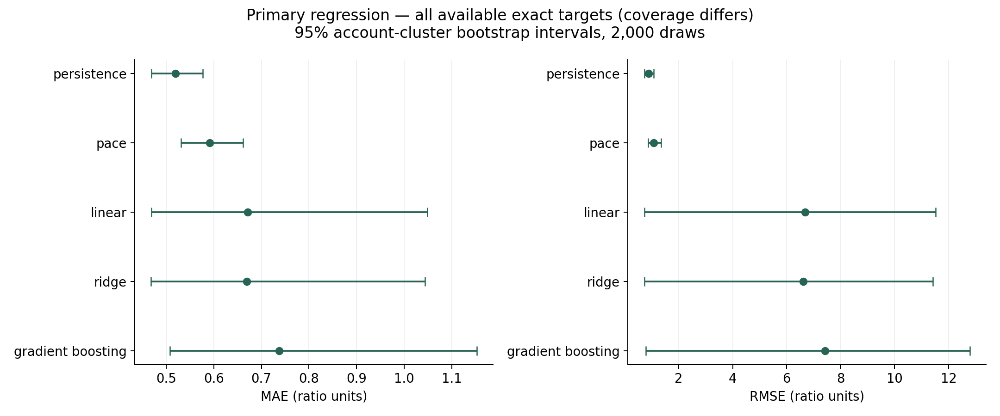
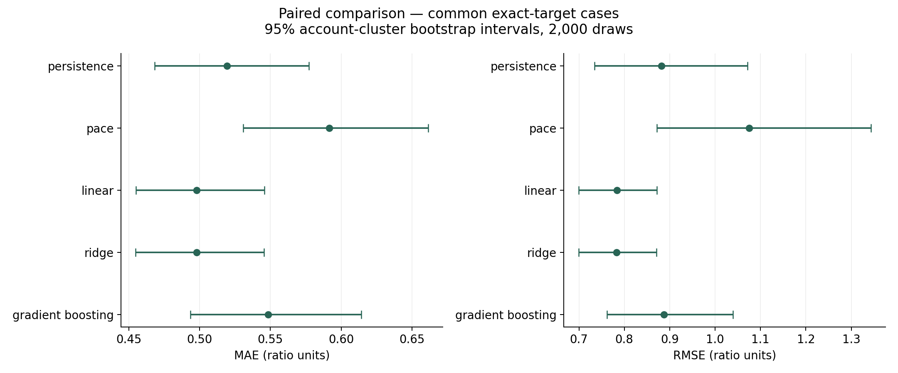
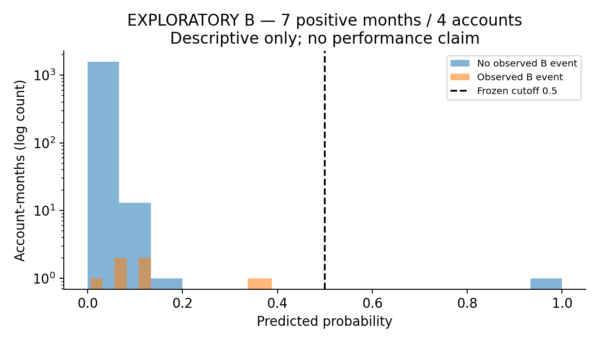
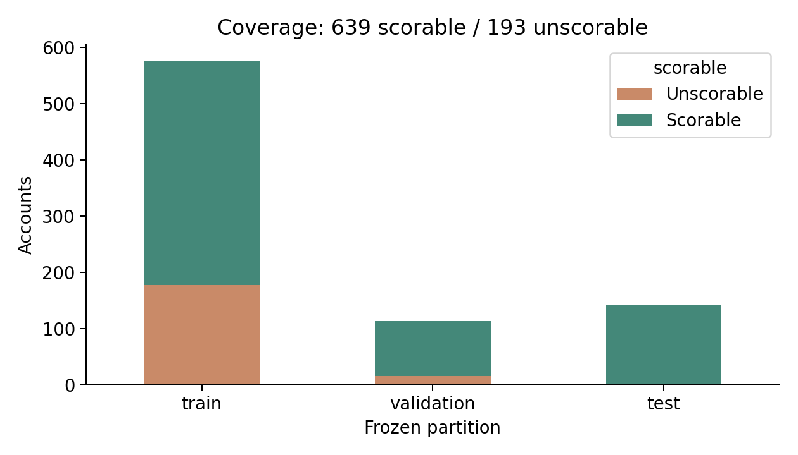
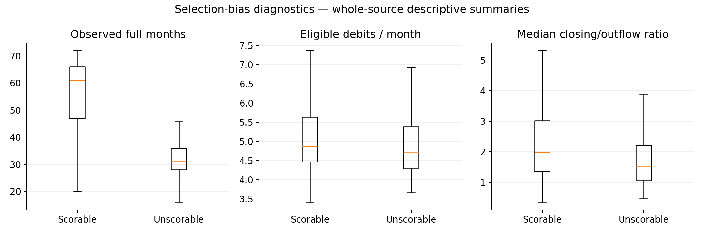

# Berka monthly low-balance modeling — completed evaluation

**Primary:** month-end balance/outflow ratio regression. **Secondary:** exploratory low-balance event B. The frozen definition, 5% thresholds, relaxed coverage, 832-account registry and account/time assignments are unchanged. All estimators were fitted from scratch; no pretrained models, recurrent networks, fictional rows, oversampling or target imputation were used.

## Authorization and development/test separation

The latest user instruction authorized training and account-grouped CV on pooled original train+validation data. This is recorded separately in `training_authorization_and_plan.json`; the original freeze JSON was not edited. Its historical `training_authorized=false` describes the earlier freeze stage, not a refusal of the later user authorization. Configuration lock: **2026-11-19T20:58:00+05:00**. Single final test prediction pass: **2026-11-19T21:03:47+05:00**. Each locked estimator made exactly one test prediction call; all subsequent metrics, plots and verification read `test_predictions_ONCE.csv`.

Outer split remains account-disjoint: original training targets through 1996, validation targets in 1997, test targets in 1998. Pooling train+validation was expressly authorized for this run; no account was reassigned and no target period was extended. The three-positive fixed validation subset was not used as an isolated tuning set.

Inner selection uses three deterministic account groups and forward validation years 1995, 1996 and 1997, giving nine possible folds. In each fold, fit only on other accounts with outcomes before the validation year. Thus validation accounts are unseen by that fold model, and its training targets precede its validation targets. All monthly features precede prediction origin. Scale parameters are fitted within each training fold; final models refit on development only. Each training account has equal total sample weight.

## Features and estimators

Eight regression features are all dimensionless: previous closing-balance lower/reference and upper/reference bounds; median previous-three-month net-flow/reference and credit/reference; previous-month net-flow/reference; and outflow/reference lags 1, 2 and 3. The exploratory binary model uses only the first five listed in `training_authorization_and_plan.json` (five actual columns: previous lower/upper, median net flow, lag-1 outflow, median credit). No current-month flow, future balance, identifiers or raw CZK value is a predictor. Unknown-operation credits remain in cash-flow/closing calculations and outside spending/anomaly/persona feature aggregates.

Unresolved previous closing snapshots are represented by observed interval bounds for learned models; no midpoint or exact closing balance is invented. Persistence and pace require a previous exact closing balance and therefore have slightly less coverage. Current-month unresolved targets are never imputed or scored as exact targets. No outputs were clipped.

| Family | Pre-test configuration |
|---|---|
| Persistence | Previous exact closing/reference scale known at origin. |
| Pace | Previous exact closing + median past-three-month net cash flow, divided by the same reference. |
| Linear regression | Unregularized linear baseline on standardized monthly ratios; equal-account weights. |
| Ridge | {'alpha': 1} |
| Shallow regression gradient boosting | {'n_estimators': 100, 'max_depth': 2, 'learning_rate': 0.05, 'min_samples_leaf': 100, 'random_state': 20261119} |
| Exploratory logistic regression | {'C': 0.1, 'solver': 'lbfgs', 'max_iter': 2000, 'tol': 1e-07, 'random_state': 20261119}; five features, L2 regularization, no class oversampling. |

Ridge candidates used alpha 0.1/1/10/100/1000; shallow regressor candidates had depth 1–2, 100 estimators and leaf minima 50–100. Logistic C candidates were 0.001/0.01/0.1, all regularized more strongly than the usual C=1 default. Selection criteria and the binary-boost gate were recorded before inspecting test predictions.

## Development results and locked choices

| Model | Grouped forward-CV common-case MAE | Grouped forward-CV common-case RMSE |
|---|---|---|
| persistence | 0.3932 | 0.7487 |
| pace | 0.4680 | 0.8341 |
| linear | 0.3923 | 0.7732 |
| ridge | 0.3920 | 0.7716 |
| gradient_boosting | 0.5358 | 1.1372 |

The development-selected primary pipeline was **ridge**, fixed before test. The shallow binary booster improved development Brier by only 0.364% versus the selected logistic model, its paired difference CI crossed zero and its average precision decreased. It failed the predeclared >=5%/paired-CI/AP gate, so no final binary booster was retained or tested. This decision did not use the seven test positives.

## Primary test result: all available exact targets

**Lead with this population, not the more favorable complete-baseline subset.** All methods below use their actual available exact targets. Coverage differs, so losses across different month sets are not a paired performance comparison.

| Model | Accounts / months | Account-macro MAE [95% CI] | Account-macro RMSE [95% CI] |
|---|---|---|---|
| persistence | 142 / 1558 | 0.519 [0.468, 0.577] | 0.882 [0.734, 1.071] |
| pace | 142 / 1558 | 0.591 [0.531, 0.661] | 1.075 [0.872, 1.344] |
| linear | 142 / 1575 | 0.671 [0.468, 1.049] | 6.680 [0.728, 11.521] |
| ridge | 142 / 1575 | 0.669 [0.468, 1.044] | 6.620 [0.727, 11.417] |
| gradient boosting | 142 / 1575 | 0.737 [0.508, 1.153] | 7.417 [0.787, 12.790] |

Development-selected ridge has full-target MAE **0.669 [0.468, 1.044]** and RMSE **6.620 [0.727, 11.417]**, on 1575 months in 142 held-out accounts. Units are ratios of typical monthly outflow, not CZK or PKR. The large RMSE and wide interval are material results, not hidden outliers.

One exact test ratio is approximately 303.57 and the locked ridge prediction is approximately 563.32. This case is among the 17 months where exact previous-closing inputs are unavailable to the persistence/pace baselines. It strongly affects the learned models' full-target RMSE. No case was removed, clipped, winsorized or used to refit a model. `post_lock_extreme_ratio_diagnostic.csv` and `extreme_ratio_notes.json` are post-lock descriptive diagnostics only.



## Fair paired comparison: common baseline cases

All five locked regression methods can be compared on the same 1,558 exact-target months in 142 test accounts. This supplementary common-case table does not replace the full-target results above.

| Model | Accounts / months | Account-macro MAE [95% CI] | Account-macro RMSE [95% CI] |
|---|---|---|---|
| persistence | 142 / 1558 | 0.519 [0.468, 0.577] | 0.882 [0.734, 1.071] |
| pace | 142 / 1558 | 0.591 [0.531, 0.661] | 1.075 [0.872, 1.344] |
| linear | 142 / 1558 | 0.498 [0.455, 0.546] | 0.784 [0.699, 0.871] |
| ridge | 142 / 1558 | 0.498 [0.455, 0.546] | 0.783 [0.699, 0.871] |
| gradient boosting | 142 / 1558 | 0.548 [0.494, 0.614] | 0.888 [0.762, 1.040] |

| Paired difference: locked ridge minus baseline | MAE difference [95% CI] | RMSE difference [95% CI] |
|---|---|---|
| persistence | -0.021 [-0.058, 0.005] | -0.099 [-0.268, 0.013] |
| pace | -0.094 [-0.146, -0.054] | -0.292 [-0.536, -0.128] |

The paired MAE and RMSE difference intervals versus persistence both include zero: **no clear improvement over persistence is established**. The paired intervals versus the specified pace rule are below zero on these common cases, but this is a result for this selected historical cohort and rule, not evidence of student-app generalization. The model preference remains the pre-test CV choice; it was not changed after seeing this table.



## Secondary binary B — EXPLORATORY only

The locked logistic model is scored on 1591 test account-months in 142 accounts. There are **7 positive months across 4 accounts**. These are too few for a reliable performance claim. Numbers below are descriptive only. The probability threshold remains 0.5, distinct from the 0.05 balance-ratio threshold.

| Descriptive metric | Value / treatment |
|---|---|
| Account-weighted average precision | 0.3430; valid-draw CI [0.011375566527864645, 0.6388888888888888] |
| Account-macro Brier | 0.005441; CI [0.001150186939048506, 0.011444826943205307] |
| Raw confusion at probability 0.5 | {'tn': 1583, 'fp': 1, 'fn': 7, 'tp': 0} |
| Zero-positive bootstrap draws | 34 / 2000 |
| Zero-negative bootstrap draws | 0 / 2000 |
| AP undefined / valid draws | 34 / 1966 |
| Precision undefined / valid draws | 728 / 1272; interval unavailable (>5% undefined). |
| Recall undefined / valid draws | 34 / 1966; valid-draw interval [0, 0]. |
| Brier valid draws | 2000; mathematically defined even on single-class resamples. |

At the frozen cutoff, the exploratory classifier has zero true positives and seven false negatives; it is not a validated warning system. AP is non-interpolated account-weighted average precision, not trapezoidal PR area. Single-class draws are left undefined for AP; recall without actual positives and precision without predicted positives are undefined. They were not replaced with zeros or resampled until positives appeared. AP/recall intervals condition on the 1,966 defined draws and remain fragile with only four positive accounts. Precision has 728 undefined draws (36.4%), so its interval is withheld under the frozen >5% rule. Every draw is saved for audit.



Month-end warnings derived by thresholding continuous predictions are evaluated against month-end low-ratio truth in `derived_month_end_warning.json`. That is a different outcome from earlier-month B; its confusion counts are not used to tune the threshold or claim event-detection performance.

## Scorable versus unscorable accounts and selection bias

| Partition | Registered | Scorable | Unscorable |
|---|---|---|---|
| Train | 577 | 400 | 177 |
| Validation | 113 | 97 | 16 |
| Test | 142 | 142 | 0 |
| Total | 832 | 639 | 193 |

Of the 193 unscorable accounts, 192 lack an eligible origin inside their assigned target period and one has only unresolved assigned targets. They are retained in the registry and are not treated as safe negatives or assigned invented regression errors. Here scorable refers to the continuous primary target: B can be observed without a uniquely resolved month-end closing balance, so one additional validation account remains available to the binary model. Model-specific common-case coverage is also reported: only 637 accounts across all partitions have exact inputs for the deterministic baselines, versus 639 with at least one exact target for learned models.

| Whole-source account median [IQR] | Scorable | Unscorable |
|---|---|---|
| Observed full months | 61.000 [47.000, 66.000] | 31.000 [28.000, 36.000] |
| Eligible debit records/month | 4.875 [4.466, 5.642] | 4.706 [4.310, 5.382] |
| Ledger records/month | 7.379 [6.708, 8.111] | 7.286 [6.639, 7.857] |
| Active debit-month fraction | 0.985 [0.976, 1.000] | 0.975 [0.962, 1.000] |
| Median month-end balance/outflow ratio | 1.987 [1.363, 3.022] | 1.513 [1.057, 2.219] |

| Partition/group | Accounts | Median debits/month [IQR] | Median closing ratio [IQR] |
|---|---|---|---|
| train/scorable | 400 | 4.937 [4.492, 5.609] | 2.098 [1.439, 3.171] |
| train/unscorable | 177 | 4.725 [4.326, 5.414] | 1.523 [1.113, 2.219] |
| validation/scorable | 97 | 4.712 [4.400, 5.600] | 1.715 [1.354, 2.453] |
| validation/unscorable | 16 | 4.362 [4.158, 4.711] | 1.044 [0.790, 2.455] |
| test/scorable | 142 | 4.941 [4.418, 5.771] | 1.742 [1.226, 2.855] |
| test/unscorable | 0 | N/A | N/A |

Scorable accounts have median first observation in November 1993 versus May 1996 for unscorable accounts, median 61 versus 31 full months, and median closing/outflow ratio approximately 1.99 versus 1.51. The evaluated sample favors longer-established, higher-buffer accounts. This is evidence of selection differences, not a causal effect or a quantified error rate for excluded accounts. Ever-negative counts are 34/639 versus 11/193, but observation spans differ; those proportions are not exposure-adjusted comparisons. Standardized mean differences and per-account summaries are saved. These whole-source diagnostics include dates beyond modeling cutoffs and were not used as training features or selection objectives. Boxplots omit flier markers for readability only; no records are removed from summaries or metrics.





## Bootstrap and audit details

Every reported regression interval uses 2,000 account-cluster bootstrap draws (seed 20261119), retaining all observed months for each sampled account. Compute mean monthly loss inside each account, then average accounts equally; RMSE is the square root of the account-macro squared loss. Paired common-case comparisons reuse identical draws. No month-level IID bootstrap or synthetic training rows are used. The draw-level MAE/RMSE and binary diagnostics are saved. Intervals are conditional on the sampled historical bank/calendar periods and do not capture all domain shift or cross-account shared economic shocks.

Verification passed: 126 grouped forward CV fits checked, 4 final development refits, fold/outer-account separation, development-only scaler means, source/protocol/cohort/split hashes, one test pass and independently reconstructed cached bootstrap intervals. The original frozen JSON SHA-256 remains `7080ca1de0a1b42b7cb79d7dfac6970a66fe6ebcb78640a73311728817feb6a8`. Reporting was updated to lead with all available exact targets; no estimator was rescored or changed during that reporting update.

## Paste-ready limitations paragraph

The continuous target is the month-end closing-balance/outflow ratio, whereas low-balance event B is an observed dip below 5% of prior typical outflow before the last calendar day; thresholding a month-end prediction does not identify every earlier dip or prove that a person lacks money elsewhere. The binary test outcome contains only seven positive account-months across four accounts, so the classifier results are exploratory and support no performance or deployment claims; 34 of 2,000 account-cluster bootstrap draws contained no positives, and undefined metrics were disclosed rather than replaced with zeros or resampled away. Only 639 of the fixed 832 accounts have exact targets in their assigned periods; 193 remain unscorable, and the scorable group has longer observed histories and higher median balance/outflow ratios, limiting population representativeness. Some closing balances cannot be uniquely ordered from dated transactions and are not imputed. Ratio errors are sensitive to small outflow denominators, producing a wide full-target RMSE interval; no test-driven clipping or threshold changes were made. Berka describes a non-student Czech banking population in 1993–1998, not contemporary Pakistani students; normalized features remove currency units but do not remove geographic, temporal or behavioral domain shift.

## Files and safe reproduction

Metrics: `regression_all_available_metrics.csv`, `regression_test_metrics.csv` (common cases), `regression_results.json`, `exploratory_binary_results.json`, `derived_month_end_warning.json`. Selection: `training_authorization_and_plan.json`, `cv_design.json`, both CV JSONs, configuration lock/digest and `pre_test_verification.json`. Audit: `test_evaluation_ledger.json`, saved predictions, bootstrap draw CSVs, `selection_bias.json`, `account_selection_bias.csv`, post-lock diagnostic and `verification.json`. Standalone plots are in `plots/`. Trained model bundles/cards are in `models/berka_low_balance_v1/`.

The development/preparation/scoring commands are documented in source, but **do not rerun the test scorer or retune models on this test**. Its exclusive ledger prevents a second scoring pass. To reproduce tables, checks and plots from the already saved predictions, from `spendsense`:

```powershell
../.venv/Scripts/python.exe eval/analyze_berka_models.py
../.venv/Scripts/python.exe eval/verify_berka_modeling.py
../.venv/Scripts/python.exe eval/render_berka_modeling.py
```
