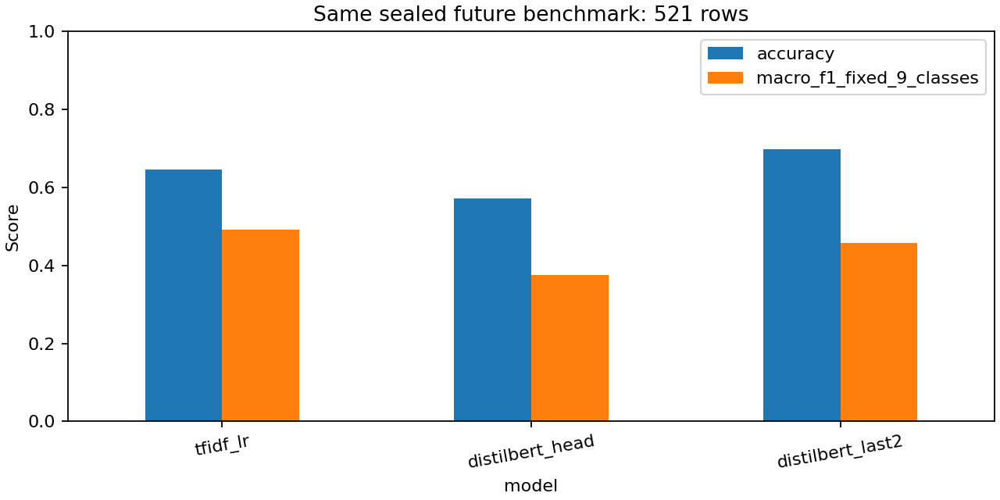

# Step 5: shared categorizer benchmark

All three candidates were rebuilt using the same 1,127 development rows and scored on the same sealed future rows. Older weights were excluded. Configurations locked before test; each model made one dataset prediction pass. These are newly model-untouched splits of previously inspected public sources, not newly collected data. No candidate is deployed.

| Model | Source | Rows | Accuracy | Macro F1 (fixed 9 classes) |
|---|---|---:|---:|---:|
| tfidf_lr | all | 521 | 0.6449 | 0.4907 |
| tfidf_lr | household | 410 | 0.7463 | 0.5508 |
| tfidf_lr | personal | 111 | 0.2703 | 0.0612 |
| distilbert_head | all | 521 | 0.5720 | 0.3749 |
| distilbert_head | household | 410 | 0.6439 | 0.4095 |
| distilbert_head | personal | 111 | 0.3063 | 0.1238 |
| distilbert_last2 | all | 521 | 0.6987 | 0.4577 |
| distilbert_last2 | household | 410 | 0.7780 | 0.4855 |
| distilbert_last2 | personal | 111 | 0.4054 | 0.1781 |

Split: per-source future final 20% of unique dates. Earlier rows sharing any held-out normalized description are purged, ensuring no normalized-description overlap. Training sees the remaining first 80%, including earlier correction/curve development partitions. The same preprocessing and rows apply to all models. Hyperparameters are predetermined; no test tuning, early stopping or automatic promotion. TF-IDF+LR is from scratch. DistilBERT uses the local original pretrained language backbone, with a fresh classification head: candidate A freezes its encoder, candidate B fine-tunes its last two blocks. This latest user-requested pretrained comparison supersedes the earlier blanket exclusion for this experiment only.

Training configurations, source/split/model hashes and row IDs are saved. Per-source/per-class precision, recall, F1 and confusion matrices are included. Zero-support categories receive zero division=0 and are included in the fixed-nine-class macro average, making the convention explicit. No label is silently removed for low support. Repeated test transactions are not independent people; unique description count and source counts are reported in metrics.json.

**Done:** common locked benchmark, identical row IDs, genuinely rebuilt candidate weights, baseline, per-source/per-class results and saved predictions. **Still unvalidated:** deployment benefit, local student language, many-user generalization, label correctness, complete logging, and a newly collected independent population. Description purging removes many recurring merchants and disproportionately shrinks the personal development data; this is a novelty-oriented benchmark with selection bias. Accuracy on common recurring text may differ. The test is now consumed and must not be used to tune another candidate or threshold. No superiority beyond these descriptive benchmark rows is established.

See metrics.csv, metrics.json, *_confusion.csv, split_lock.json, model_plan.json, configuration_lock.json and test_evaluation_ledger.json. Regenerate reports only with `python training/category_benchmark.py report`. Never rerun its score command or the frozen Berka evaluator.

## Observed failures and tradeoffs

The frozen-encoder candidate did not beat TF-IDF+LR on aggregate accuracy or macro F1. Fine-tuning the last two blocks had higher row accuracy (69.87% vs 64.49%) but lower fixed-nine-class macro F1 (0.4577 vs 0.4907). Personal-source accuracy is only 27.03%, 30.63% and 40.54%, respectively. This does not establish an overall winner or acceptable performance for students. Independent saved-prediction verification passed; it performed no fitting or prediction.
