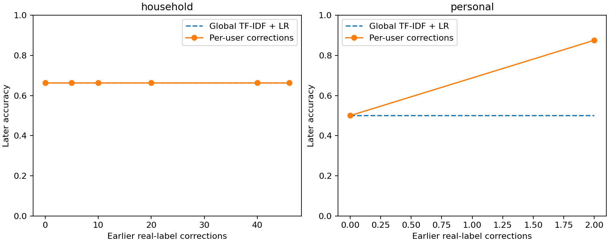

# Step 4: per-user categorization corrections

Completed 20 November 2026. **84 regression tests passed** (test_suite.log), including six focused correction/chronology checks and an authenticated mobile preview→apply→next-suggestion test.

## Implemented flow

"Change to Food", "change last expense to Groceries" or "change transaction 123 to Transport" prepares an account-bound preview. The selected entry description, old/new category and unchanged cash are shown. Apply updates the ledger category and the per-user correction layer atomically; cancel/preview does not learn. History also exposes a category correction control. Cross-account edits are rejected. Replays do not duplicate feedback, and later corrections can change a description back to a previously used category.

The shared global classifier stays unchanged. Exact normalized descriptions use that user's latest reviewed label. Otherwise character TF-IDF nearest corrections require fixed similarity >=0.85; conflicting ties abstain to the global prediction. No correction crosses account boundaries. This layer wraps desktop and mobile suggestions, including when no global model is available. Similarity scores are not calibrated class probabilities. It does not use the chatbot to infer a training label.

## Real chronological learning curve

These are retrospective feedback replays of real published labels, not observed live-user corrections. The global model for this curve is **from-scratch TF-IDF + logistic regression**, not the legacy app's DistilBERT. The correction layer can wrap either, but no DistilBERT personalization gain is claimed here.

Within each source, unique-date cutoffs separate earliest 60% global fitting, next 10% correction feedback, next 10% fixed later evaluation and final 20% sealed for the shared step-5 benchmark. Rows sharing a normalized description with the sealed benchmark are purged from all development partitions. The sealed benchmark is not opened by this experiment. This leaves 894 initial training rows, 139 correction-pool rows and 94 curve-evaluation rows. Feedback is the first N global errors in chronological order, using existing publisher categories; no evaluation label enters feedback. All budgets evaluate identical later rows. The fixed 0.85 gate and budgets were recorded before fitting; no curve-dependent tuning was performed.

| Source | Later evaluation rows | Available corrections | Global correct | Personalized at max feedback |
|---|---:|---:|---:|---:|
| One household | 86 | 46 | 57/86 (66.28%) | 57/86 (66.28%) |
| One personal history | 8 | 2 | 4/8 (50.00%) | 7/8 (87.50%) |

Budgets: 0, 5, 10, 20, 40, 80 and 160 per history, capped at available feedback. Actual counts, all per-row predictions and chronological correction pools are saved. At zero corrections the global and personalized outputs are identical. The personal source saturates at two corrections, so higher requested budgets are not additional evidence.

**Failed improvement claim:** household feedback produced no overrides on later evaluation rows and no accuracy gain. The personal difference is three additional correct predictions among eight rows; it is a small descriptive case, not reliable population evidence. Do not advertise a proven personalization improvement.

**Still unvalidated:** live correction frequency and trustworthiness, downstream model calibration, learning on contemporary students, generalization across many users, robustness to changing label meanings and long-term benefit. Public reference authenticity/logging coverage and inherited category mappings retain their earlier limitations. The two histories are not a user cohort. No generated transaction or fictional student profile is used.

## Shared benchmark preparation

The future benchmark was sealed before this experiment: eval/category_benchmark_v1/split_lock.json. All future descriptions were purged from development (776 rows), leaving 1,127 development rows and 521 sealed benchmark rows. This makes the future benchmark deliberately stricter and reduces representative recurring-merchant coverage, especially in the personal source. It is a **new model-untouched experiment on previously inspected public sources**, not newly collected or historically unseen data. Old candidate weights previously saw overlapping data and are excluded from the forthcoming comparison; all candidates must be rebuilt from the same development split.

Reproduce: `python training/prepare_category_benchmark.py` (will not overwrite the sealed split), then `python training/evaluate_personalization.py`. The latter reads development only. See plan.json, learning_curve.csv and predictions.csv. No Berka model, frozen-test artifact or PKR wallet was used by the experiment.
