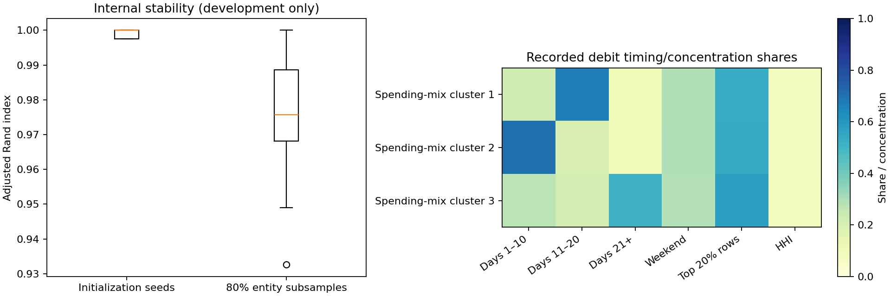

# Step 1: real-data spending-mix clusters

Completed removal and research rebuild. No Berka model is deployed into the app. The frozen Berka protocol, split, fitted artifacts and saved test predictions remain byte-for-byte unchanged; no frozen test scoring was performed.

## What was removed

Known generated student profiles, their duplicate download, generated student transactions, the seeded campus CSV and the unverified student survey were moved outside the project. Campus/demo monetary models, old identity cluster artifacts and their evaluation summaries were retired too. Download/training/evaluation entry points no longer generate or consume them. The training CLI accepts only hash-verified approved real reference CSVs; its generated-data mode was removed. App workspaces now offer My finances and Household sample. Known generated transaction rows were removed after a complete SQLite backup; all other transaction rows were checked unchanged. Existing wallet settings and user-entered records were preserved. See retirement.json for hashes and the reversible external archive location.

Current docs, mobile copy and demo instructions no longer present those datasets or their scores as active examples. Removal notices and provenance records remain so retirement is auditable. Old personal/household persona artifacts are retired in favor of the single research rebuild. The app shows recorded category proportions, without assigning a cluster or identity; mobile returns no fitted style.

## Protocol and coverage

Fixed K=3, K-Means n_init=20, final seed 42; choices recorded in plan.json before fitting. No test-based selection or choice of the best-looking seed. Berka uses only train-assigned accounts and the six-month window July–December 1996. Validation/test accounts are not profiled or scored. All sources require six complete calendar months within the observed span, at least 20 eligible positive debits and at least five active months (80% of six). Observed span does not certify complete logging.

| Source | Profiles | Recorded entities | Total fit weight |
|---|---:|---:|---:|
| Berka development | 1,130 | 1,130 accounts | 1,130 |
| Household, INR | 7 nonoverlapping windows | 1 household | 1 |
| Personal reference, units unspecified | 3 nonoverlapping windows | 1 history | 1 |
| Total | 1,140 | 1,132 | 1,132 |

Each entity has total fitting weight one. Repeated windows split that weight; they are not invented users. There is no currency conversion or pooling of raw monetary units. The pooled result is dominated by Berka; adding two reference histories does not validate cross-domain transfer.

## Comparable features and meaning

Six dimensionless features, all in [0,1]: amount shares on calendar days 1–10, 11–20 and 21–end; weekend amount share; amount share of the largest ceil(20% of debit count) transactions; and transaction Herfindahl concentration (sum of squared individual debit shares). No fitted scaling, monetary amounts, IDs, balance outcomes or student attributes are predictors. Unknown-operation rows are excluded from every Berka numerator and denominator. Known-operation debit types VYDAJ/VYBER are retained, including fees/loans/cash withdrawals. Cash withdrawals do not reveal their subsequent use.

**Unsupported:** Berka has no comparable food, shopping, merchant or subscription labels. A combined food/shopping category model would invent information. This rebuild therefore describes recorded debit **timing/concentration**, explicitly, rather than claiming those categories. Calendar weekends differ in meaning across countries/eras. The three centers mainly describe mid-month (67% on days 11–20), early-month (70% on days 1–10), and later-month (51% on days 21–end) debits. Names remain neutral: Spending-mix cluster 1/2/3. No student or psychological identities are assigned.

## Internal stability

| Diagnostic | Repeats/comparisons | Minimum ARI | Median ARI | Maximum ARI |
|---|---:|---:|---:|---:|
| 20 initialization seeds, all pairwise | 190 | 0.997566 | 1.000000 | 1.000000 |
| Independent 80% entity subsamples, assignments compared on all development profiles | 20 | 0.932581 | 0.975715 | 1.000000 |

Unweighted descriptive silhouette: **0.400584**. Fits use equal-entity weights; sklearn's silhouette/ARI are unweighted internal diagnostics and the repeated reference windows are not independent evidence. Seed stability alone does not establish predictive accuracy, population validity, usefulness or the correct number of clusters. K=3 was fixed for this descriptive rebuild, not claimed optimal. No untouched out-of-sample clustering benchmark was run.

Full centers, source-by-cluster counts, eligibility, per-profile features, hashes and all ARIs are saved beside this report. The artifact models/spending_mix_research_v1/clusters.joblib is marked research_only and deployable=false. App loaders do not reference it.

## Source provenance and remaining limitations

Original Berka hashes match the verified source archive. Personal Finance metadata explicitly describes real-world 2018–2019 transactions (publisher-reported MIT); it contains none of synthetic/fictional/generated/simulated. Its collection authenticity and monetary units remain independently unverified. Household metadata (publisher-reported CC0) has an empty description; the user-approved household record is retained with original source-attribution uncertainty. Existing cleaning rules are inherited rather than independently relabelled. No known fictional/generated source was used; the supplied public metadata cannot certify independent collection authenticity. Local metadata hashes and reviews are saved, without treating public availability as proof of authenticity.

## Done / failed / unvalidated

- **Done:** known fictional sources and derived artifacts retired from training, evaluation, demo and active docs; scale-free research clusters rebuilt from approved real-source records; internal seed/subsample stability reported; generated-data training path closed; currency invariance, eligibility and test-artifact isolation tested.
- **Unsupported:** a common food/merchant spending-category clustering cannot be built from Berka's fields. Timing/concentration features are documented explicitly instead.
- **Unvalidated:** collection authenticity for the two public reference histories, logging completeness, optimal K, independent out-of-sample cluster stability/usefulness, Pakistani-student relevance and user benefit. No deployment or identity claims.
- **Next:** P0 accounting fixes and regression tests (step 2). Advice guard, personalization, shared categorizer benchmark, end-to-end survival evaluation and APK work remain pending their ordered steps.

Reproduce only this development-only research experiment: `python training/build_spending_mix.py`; checks: `python -m unittest discover -s tests -p test_spending_mix.py -v`. Never rerun the frozen Berka test evaluator. This renderer reads saved metrics only.
