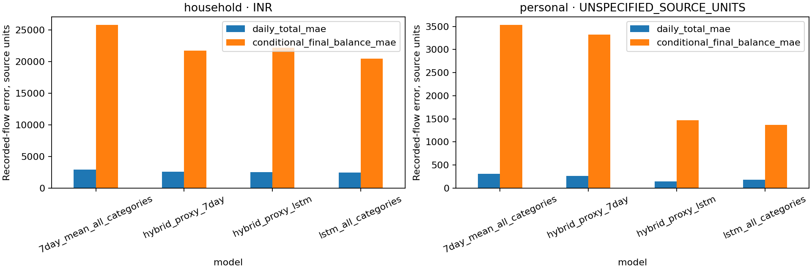

# Step 6: partial survival-pipeline evaluation

**Full end-to-end survival validation is not established.** Neither source contains verified opening cash, essential-budget inputs, forward due schedules or actual exhaustion dates. No cash balance, allowance or exhaustion label is invented. Berka is not used; its completed models and frozen test remain untouched.

Two separate from-scratch LSTMs use real historical recorded expenses, train-only scaling and fixed recursive 14-day rolling-origin predictions. No observation inside a forecast horizon is fed back, and the fixed fitted models are never updated on the final period. Amounts stay in INR or unspecified personal-source units, without pooling or PKR conversion. Existing app composition is shared through hybrid_daily_costs, but missing real user inputs force a documented past-only essential-cost proxy and no known future dues. An omitted due schedule means unavailable information, not verified zero obligations. Bills/Health/Education are not fully covered by this proxy.

| Source | Model | 14-day windows | Daily MAE | Daily RMSE | Conditional final-balance MAE | Conditional RMSE |
|---|---|---:|---:|---:|---:|---:|
| household | 7day_mean_all_categories | 19 | 2897.74 | 5977.82 | 25788.38 | 37529.03 |
| household | hybrid_proxy_7day | 19 | 2592.25 | 5715.49 | 21720.09 | 28411.23 |
| household | hybrid_proxy_lstm | 19 | 2485.57 | 5650.55 | 22188.40 | 25550.32 |
| household | lstm_all_categories | 19 | 2471.00 | 5576.08 | 20439.81 | 21809.28 |
| personal | 7day_mean_all_categories | 9 | 306.43 | 928.86 | 3531.28 | 6298.05 |
| personal | hybrid_proxy_7day | 9 | 258.91 | 933.28 | 3328.11 | 6425.09 |
| personal | hybrid_proxy_lstm | 9 | 141.82 | 841.36 | 1471.99 | 3071.38 |
| personal | lstm_all_categories | 9 | 175.12 | 836.67 | 1365.34 | 2779.05 |

The conditional final-balance error is the negative cumulative spending error over 14 days. It equals a balance prediction error **only conditional on the same true initial balance and future income being supplied to both trajectories**. It is not an evaluated absolute account balance. Exhaustion-date error is **not estimable**, because its ground truth and starting cash are absent. No censoring date is silently treated as "never exhausted".

**Done:** recursive daily-total recorded-flow errors, cumulative/conditional balance errors, statistical baseline comparison, shared hybrid cost composition, train-only scaling and saved per-day/per-window predictions on two real reference histories. **Failed to validate:** absolute final balances, actual exhaustion timing, the true shield with real essential budgets/dues, and a reliable student survival predictor. The hybrid proxy must not be presented as a validated survival model.

**Still unvalidated:** true spending on unlogged days (a calendar slot with no record means recorded total zero, not proof of no spending), inherited category/transfer treatment, reference collection authenticity, future income uncertainty and independent people/student performance. Nonoverlapping windows from one household and one personal history are not independent users. A consented prospective dataset needs timestamped verified opening cash, income/allowance dates, budgets, commitments, complete daily expenses and observed balance/exhaustion outcomes before those claims can be tested.

Artifacts: plan.json, configuration_lock.json, metrics.csv/json, daily_predictions.csv, window_predictions.csv. Evaluation is locked; do not retune using these outcomes. New research models remain outside the app.
